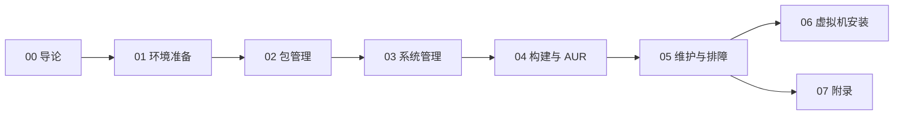

# Arch Linux 学习手册（WSL 版）

> 一本按主题组织的 Arch Linux 系统学习书：从 WSL 环境出发，掌握包管理、systemd、打包、维护与安装。

版本：v1.0  
更新：2026-10-27  
主要参考：[Arch Wiki](https://wiki.archlinux.org/title/Main_page)

---

## 这本书是什么

这不是 Arch Wiki 的替代品，而是一条**有顺序的学习路径**和一份**可执行的操作手册**。

- 面向有 Ubuntu / Fedora 使用经验、但不熟悉 Arch 的读者。
- 以 WSL 作为主要实验环境，先练包管理、systemd、打包和排障。
- 对 WSL 无法覆盖的安装、引导、内核、磁盘加密，单独用虚拟机章节补齐。
- 每章都有概念、命令、练习和自检，读完后能验证自己是否真的掌握。

## 适合谁

- 用过 Linux，能看懂基本命令和权限概念。
- 已在 WSL 中安装 Arch，或准备安装。
- 想系统理解 Arch，而不是只会复制几条命令。
- 愿意动手、愿意在出错后看日志和查 Wiki。

## 不适合谁

- 完全没接触过 Linux 命令行的读者。
- 只想找「一键安装桌面」教程的读者。
- 不打算备份、也不打算排障的读者。

## 前置条件

- Windows 10/11，已启用 WSL 2。
- 已安装 Arch WSL 镜像（官方镜像或社区 ArchWSL 均可）。
- 能访问 Arch 镜像站和 Arch Wiki。
- 有一份可用的备份位置（本地磁盘或移动硬盘）。

## 全书结构

| 部分 | 主题 | 目标 |
| --- | --- | --- |
| [00 导论](00-导论/) | Arch 是什么、学习地图、WSL 边界 | 建立正确预期 |
| [01 环境准备](01-环境准备/) | 首次启动、systemd、用户、镜像源、备份 | 得到可用的实验环境 |
| [02 包管理](02-包管理/) | pacman、查询、缓存、降级、密钥环 | 掌握 Arch 的核心工具 |
| [03 系统管理](03-系统管理/) | systemd、日志、service、timer、权限 | 能管理系统与服务 |
| [04 构建与 AUR](04-构建与-AUR/) | makepkg、PKGBUILD、AUR | 能自己构建和安装包 |
| [05 维护与排障](05-维护与排障/) | 升级流程、故障处理、WSL 特有问题 | 能长期维护系统 |
| [06 虚拟机安装](06-虚拟机安装/) | 分区、pacstrap、chroot、引导器 | 补齐 WSL 缺失的安装能力 |
| [07 附录](07-附录/) | 命令速查、Wiki 索引、术语、里程碑 | 随时查阅 |

完整目录见 [SUMMARY.md](SUMMARY.md)。

## 推荐学习顺序

顺序不是绝对约束，但建议遵守：

1. 先完成 00 和 01，确保环境正确。
2. 02 是全书重点，必须练熟。
3. 03 和 04 可以交替学习，但不要跳过 02。
4. 05 在有过一次真实升级和排障经历后再读，效果最好。
5. 06 放到最后，用虚拟机完整走一遍安装。

## 每章怎么读

建议按四步走：

1. **读概念**：先理解这一章解决什么问题。
2. **敲命令**：在 WSL 中逐条执行，观察输出。
3. **做练习**：每章末尾的练习至少完成一半。
4. **过自检**：自检项全部能解释清楚，再进入下一章。

不要只读不敲。Arch 的很多细节只有在命令输出和错误信息里才会暴露。

## 本书约定

- 命令块中的 `sudo` 表示需要管理员权限；如果你当前是 root，可以去掉 `sudo`，但不要长期以 root 身份操作。
- 标注「危险」的命令可能删除数据或破坏系统，执行前必须确认路径和备份。
- 命令以当前 Arch Wiki 为准；Wiki 更新后，个别参数可能变化。
- 所有 Wiki 链接都放在各章末尾的「参考」一节。
- 本书不提供「一键脚本」，也不鼓励复制来源不明的 PKGBUILD。
- 书中不估算学习时间，只给出顺序和验收标准。

## 学习进度

| 部分 | 状态 | 完成日期 |
| --- | --- | --- |
| 00 导论 | 未开始 | |
| 01 环境准备 | 未开始 | |
| 02 包管理 | 未开始 | |
| 03 系统管理 | 未开始 | |
| 04 构建与 AUR | 未开始 | |
| 05 维护与排障 | 未开始 | |
| 06 虚拟机安装 | 未开始 | |
| 07 附录 | 未开始 | |

## 参考与声明

- 主要参考：[Arch Wiki](https://wiki.archlinux.org/title/Main_page)、[Installation guide](https://wiki.archlinux.org/title/Installation_guide)、[Pacman](https://wiki.archlinux.org/title/Pacman)、[systemd](https://wiki.archlinux.org/title/Systemd)、[Makepkg](https://wiki.archlinux.org/title/Makepkg)、[AUR](https://wiki.archlinux.org/title/Arch_User_Repository)、[WSL](https://wiki.archlinux.org/title/WSL)。
- 本书是学习材料，不构成对任何操作的安全保证。执行破坏性命令前请自行备份。
- Arch 是滚动发行版，任何命令都可能随软件版本变化；遇到不一致时，以 Wiki 和 `man` 为准。
