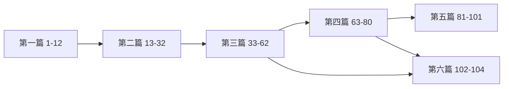

# Linux 与 Arch Linux 系统学习手册

> 一本由易及难的 Linux 系统学习书：从命令、文件、权限，到进程、存储、网络，再到 Arch Linux 的包管理、systemd、构建与排障，最后把 Web、数据库、桌面与多媒体真正跑起来。

版本：2026-11-04（全量精讲与结构重整版）
主要参考：[Arch Wiki](https://wiki.archlinux.org/title/Main_page)

---

## 这本书是什么

这不是 Arch Wiki 的替代品，而是一条**有顺序的学习路径**和一份**可执行的操作手册**。

- 面向「已经会 `ls`、`cp`、`mv`、`vim`，能在 Linux 上完成开发工作，但对系统本身（进程、权限、包、启动）只有模糊印象」的读者。
- 六篇路径：**Linux 基础 → Linux 系统机制 → Arch Linux 实操 → 应用、服务与运维 → 桌面、多媒体与应用生态 → 附录**。
- 每章都有概念、可执行命令、失败模式、练习、自检与 Wiki 参考；读完能验证自己是否真的掌握。

## 全书结构

| 篇 | 章 | 主题 | 目标 |
| --- | --- | --- | --- |
| [第一篇 Linux 基础](01-Linux-基础/) | 1-12 | 发行版、命令、文件、文本、文件系统、权限、用户、sudo、环境变量、综合实验、进程与 /proc | 建立普通用户视角的完整系统观 |
| [第二篇 Linux 系统机制](02-Linux-进阶/) | 13-32 | 进程、脚本、终端、存储、RAID、加密、磁盘恢复、网络、防火墙、SSH、DNS、排障、软件安装、启动与服务概念、体系结构 | 能管理系统资源与网络 |
| [第三篇 Arch Linux 实操](03-Arch-Linux/) | 33-62 | 安装、pacman、systemd、构建、AUR、仓库、升级、备份、维护、救援、性能、启动、固件、Secure Boot | 能独立安装并长期维护一台 Arch |
| [第四篇 应用、服务与运维](04-应用与服务/) | 63-80 | systemd 托管、Web、TLS、数据库、可观测性、容器、虚拟化、安全 | 能把服务跑起来并守住边界 |
| [第五篇 桌面、多媒体与应用生态](05-桌面与生态/) | 81-101 | 图形栈、驱动、Wayland、桌面环境、音频、视频、打印、电源、输入法、浏览器与办公、游戏与创作、应用选型 | 能搭好并维护日常桌面 |
| [第六篇 附录](06-附录/) | 102-104 | 命令速查、Wiki 索引与术语、常见坑与里程碑 | 随时查阅 |

完整目录见 [SUMMARY.md](SUMMARY.md)。

## 推荐学习顺序

顺序不是绝对约束，但建议遵守：

1. **第一篇不要跳**。它建立了后面所有章节共用的词汇：进程、权限、inode、FHS。
2. 第二篇的进程、存储与网络是第三篇的前置；可按需调整顺序。
3. 第三篇的 pacman（41-43）与 systemd（44-45）是全书主干，必须练熟。
4. 第四篇建议先读第 63 章（用 systemd 托管应用），它是后面所有服务的底座。
5. 第五篇按硬件条件选读；没有对应设备时，用正文给出的等价验证路径。

上面是公共主干。按目标细分的三条路线（桌面日常、服务器运维、安全与底层）见[第 104 章 §104.3](06-附录/104-常见坑与里程碑.md)；三条路线都先完成前两篇，再按重点章分叉。

## 使用约定

- 每章固定结构：`> 本章目标`、`> 对应 Wiki`、正文、失败模式与验证/回滚、取舍边界、`## 小结`、`## 练习`、`## 自检`、`## 参考`。第 1–12 章把失败模式、验证与取舍写成节内加粗小标题（如「常见失败」「验证方式」「取舍边界」），内容项不变。
- 练习默认可在虚拟机完成。少数内容只在特定条件下成立（例如需要 Live ISO、需要物理机验证固件、需要两块磁盘），正文会在该处用一句话说明，不再使用环境标签。
- 高风险操作必须先做快照或备份，并给出等价的安全验证路径；破坏性命令会明确标注后果。
- 命令与参数以 Arch Wiki、man 页和官方文档为准；版本敏感行为会注明适用版本。

## 不适合谁

- 完全没接触过命令行的读者（先补命令与文本编辑）。
- 只想找「一键装桌面」脚本的读者。
- 不打算备份、也不打算看日志的读者。
